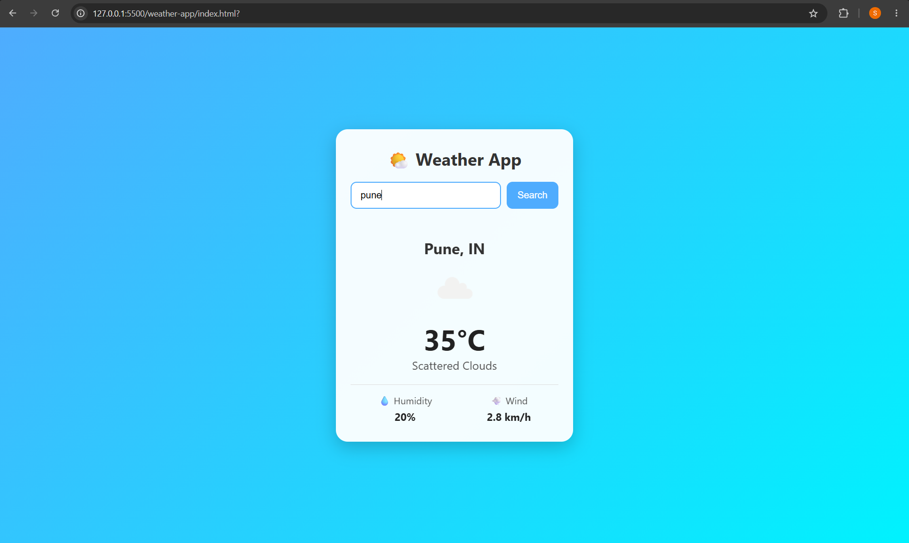
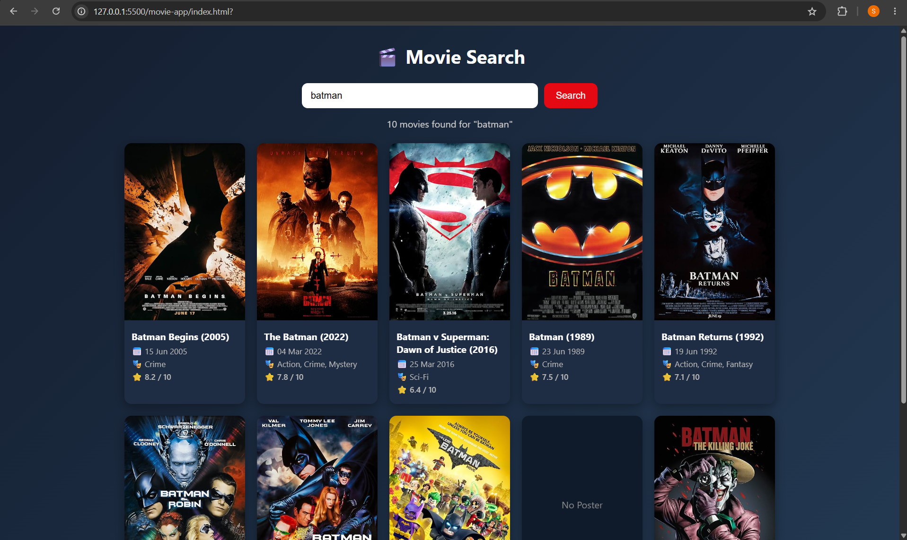

# weather-movie-app
“Weather App + Movie Search App using public APIs”
# Weather App + Movie Search App

Two interactive web applications built with HTML, CSS and modern JavaScript (ES6+) that fetch and display real-time data from public APIs.

This is **Minor Project 03** of the Unlox Web Development course.

## Features

### Weather App
- Search weather by city name
- Shows current temperature and weather condition
- Shows humidity and wind speed
- Handles errors gracefully (city not found, invalid API key, empty input, network error)
- Responsive UI

### Movie Search App
- Search movies using the OMDb API
- Shows movie poster, title, release date, genre and IMDb rating
- Handles invalid searches (no results, too many results, empty input, network error)
- Fallback box when a poster is not available
- Responsive grid layout

## Tech Stack
- HTML5
- CSS3 (Flexbox, Grid, Media Queries)
- JavaScript (ES6+)
- OpenWeatherMap API
- OMDb API
- Git & GitHub

## JavaScript Concepts Used
- Arrow functions
- Template literals
- Destructuring
- ES Modules (`import` / `export`)
- Promises and `Promise.all`
- `async` / `await`
- Fetch API
- Error handling with `try` / `catch`
- DOM manipulation, event handling and form processing

## Screenshots

### Weather App


### Movie Search App


## Project Structure

```
weather-movie-app/
├── weather-app/
│   ├── index.html
│   ├── style.css
│   ├── script.js
│   ├── api.js
│   ├── ui.js
│   └── config.example.js
├── movie-app/
│   ├── index.html
│   ├── style.css
│   ├── script.js
│   ├── api.js
│   ├── ui.js
│   └── config.example.js
├── screenshots/
└── README.md
```

## Setup Instructions

1. Clone the repository:
```
   git clone https://github.com/sidhant2206-tech/weather-movie-app.git
   cd weather-movie-app
```

2. Get free API keys:
   - Weather: [OpenWeatherMap](https://openweathermap.org/api)
   - Movies: [OMDb API](https://www.omdbapi.com/apikey.aspx)

3. Create the config files. In both `weather-app` and `movie-app`, copy `config.example.js` to `config.js` and add your key:
```js
   export const API_KEY = "YOUR_API_KEY_HERE";
```
   (`config.js` is listed in `.gitignore`, so your keys are never pushed to GitHub.)

4. Run with a local server (ES modules do not work when you double-click the file). In VS Code, install the **Live Server** extension, right-click `index.html` and choose **Open with Live Server**.

## Author

Sidhant Shirsat 